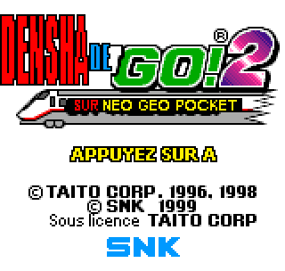
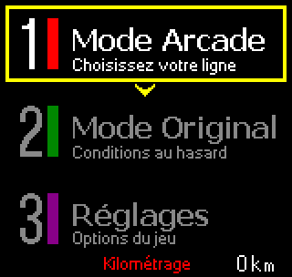
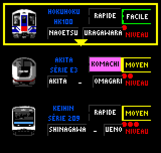
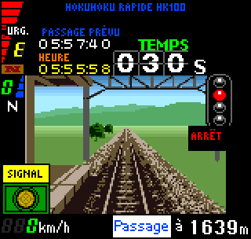

# Densha de Go! 2 — traduction française

**Densha de Go! 2 on Neo Geo Pocket** (Neo Geo Pocket Color, Taito / SNK, 1999), simulateur de conduite
de trains, entièrement en français. Le jeu n'a pas de texte au sens propre : tout est dessiné en images.
La traduction est donc **100 % graphique**. Elle couvre l'écran titre et son logo, les menus, les réglages,
le choix du train, le tableau des départs, la carte de ligne, toute l'interface de conduite (signaux,
messages de gare, incidents, panneaux, pénalités), le bilan d'arrêt, l'évaluation, le classement, le
registre, le générique, le jeu bonus d'attelage et le stage bonus. C'est vrai **en couleur comme en noir
et blanc** (Neo Geo Pocket d'origine). Un **mode d'emploi en français** est fourni.

<p align="center">
  
  
  
  
</p>

- **Partie 1 (français)** : jouer en français — le patch et comment l'appliquer.
- **Part 2 (English)** : the tools that rebuild the French ROM, and how to adapt them to another language.

---

# Partie 1 — Jouer en français

## 1.1 Ce qu'il vous faut

- Le patch : `patch/DenshaDeGo2_FR_v1.0.ips`.
- Le mode d'emploi : `patch/DenshaDeGo2_FR_Manuel.pdf`.
- **Votre propre** copie de la ROM japonaise, non modifiée. Le jeu n'existe en dump que sous la forme
  d'une version **Beta**. Aucune ROM n'est fournie ici. Vérifiez votre copie :

| | |
|---|---|
| Nom (par exemple) | `Densha de Go! 2 on Neo Geo Pocket (Japan) (Beta).ngc` |
| Taille | 4 194 304 octets |
| CRC32 | `2FC4623E` |
| MD5 | `13f0584aeab81fdbcdb09bc89367bd89` |
| SHA-1 | `4934987cd275a013d05d02b1ddd8fd1fb2ded0da` |

Le patch ne marche qu'avec ce fichier. Avec une ROM déjà modifiée ou un autre dump, vous obtiendrez un jeu
cassé. Si un émulateur a déjà écrit des classements dans votre fichier, ses empreintes ne correspondront
plus. Repartez alors d'une copie propre.

## 1.2 Méthode A — patch appliqué à la volée par l'émulateur

L'émulateur applique le patch en mémoire à chaque lancement : la ROM d'origine n'est **pas modifiée**.
Posez le fichier `.ips` à côté de la ROM, **sous le même nom**, puis lancez la ROM normalement :

```
Densha de Go! 2 on Neo Geo Pocket (Japan) (Beta).ngc
Densha de Go! 2 on Neo Geo Pocket (Japan) (Beta).ips
```

## 1.3 Méthode B — créer une ROM française (console, ou tout autre émulateur)

Fabriquez une fois pour toutes une ROM patchée. Deux possibilités :

- avec un outil IPS courant : **Rom Patcher JS** (dans le navigateur), **Flips** ou **Lunar IPS**.
  Choisissez la ROM, puis le `.ips`, et enregistrez le résultat ;
- avec l'outil fourni (Python 3) :

  ```
  python tools/ips.py apply "Densha de Go! 2 on Neo Geo Pocket (Japan) (Beta).ngc" patch/DenshaDeGo2_FR_v1.0.ips DenshaDeGo2_FR.ngc
  ```

La ROM obtenue doit avoir ces empreintes, quel que soit l'outil :

| | |
|---|---|
| Taille | 4 194 304 octets |
| CRC32 | `1451979C` |
| MD5 | `01c6ab9265f444a88df5e32aa7768a75` |
| SHA-1 | `b776688b93b7ec4c4d18c9914973525e00591eb6` |

## 1.4 Ce qui a été vérifié, ce qui ne l'a pas été (v1.0)

Vérifié à l'émulateur, en couleur et en noir et blanc :
- tous les écrans fixes et les 9 écrans de réglages ;
- les trois lignes du jeu de base, conduites jusqu'au terminus. Une partie japonaise et une partie
  française identiques donnent les mêmes classements, et la sauvegarde reste intacte ;
- le jeu de parcours avancé (croix → sur l'écran de choix), dont la ligne 681 HAKUTAKA jusqu'au générique ;
- le jeu bonus d'attelage (réussi et raté) ;
- le stage bonus Morioka → Shin-Hanamaki ;
- la saisie du nom au registre.

Pas encore vu en situation :
- les panneaux « Attention 45 km/h » et « Vigilance 25 km/h ». Ils n'apparaissent qu'avec un trafic
  particulier. Ils ont été contrôlés en rendu, pas en jeu ;
- les noms par défaut du classement (209, HK100, E3, 681). Ils n'apparaissent qu'avec une sauvegarde
  **neuve**.

La ROM n'a pas encore été essayée sur une vraie console. Un retour est bienvenu si un écran est resté en
japonais ou s'affiche mal.

## 1.5 Choix de traduction

- Il n'existe aucune traduction française officielle de la série. Tout est traduit **depuis le
  japonais**, avec le vocabulaire de la notice officielle, sans s'aligner sur les traductions anglaises
  de fans.
- Signaux : 進行 **Voie libre**, 停止 **Arrêt**, 減速 **Ralentir**, 注意 **Attention**,
  警戒 **Vigilance**, 中継 **Répétiteur**. Jauge de frein : 非常 **URG.**, 解除 **LIBRE**, 切 **N**
  (neutre). Notes de l'évaluation : cachets **TB / B / P / I** (très bien… insuffisant).
- Quand la place manque, les mots sont abrégés. Par exemple « pén. » pour pénalité, « Accél. en gare »,
  ou S-HANAMAKI, HK-OSHIMA et MUSHIGAWA sur la carte de ligne. Les noms de gares et de trains sont en
  rōmaji.
- Écran titre redessiné : DENSHA DE GO!2 SUR NEO GEO POCKET. Le logo combine des sprites et les deux plans
  de décor pour tenir dans la mémoire vidéo.
- Saisie du nom : les deux kanji (系, 形) et 終 (fin de saisie) deviennent É È Ê À Ç Ô ! ' + et ✓.
- Laissé tel quel : l'insigne 「鉄」 de la casquette du conducteur sur les illustrations (élément de
  décor).

## 1.6 Mode d'emploi

`patch/DenshaDeGo2_FR_Manuel.pdf` est un mode d'emploi en français de 21 pages. Il est traduit de la
notice japonaise et adapté à cette version Beta : la Beta n'a pas de démo, mais elle a un Classement au
menu. Les commandes y sont décrites d'après l'écran du jeu, et le mode d'emploi est illustré de captures
de la version française.

## 1.7 Crédits

- **Traduction française, graphismes, mode d'emploi, outils** : **Tixul**. Les outils sont sous
  **licence MIT** (fichier `LICENSE`).
- *Densha de Go! 2* © 1996, 1998 Taito / © 1999 SNK. Ce projet de fans n'est ni affilié aux ayants droit
  ni approuvé par eux. Il ne contient **ni ROM, ni BIOS, ni graphisme d'origine** : le patch ne contient
  que des octets modifiés.

---

# Part 2 — Tools (English)

The game has no text encoding: every word is a picture (2 bpp tiles, uncompressed). The tools redraw each
screen from French strings and TrueType fonts. They re-encode the tile maps, reuse the tiles freed by the
Japanese text, and write the result into a copy of the Japanese ROM. They do this for both the colour and
the monochrome data. The build is byte-for-byte reproducible: it gives exactly the released patch.

| Folder / file | Content |
|---|---|
| `tools/` | build the French ROM and the IPS patch |
| `patch/` | the released French patch and manual |
| `screenshots/` | the screenshots shown at the top of this file |
| `FORMAT.md` | technical notes on the ROM: screens, tile maps, sprites, driving HUD (in French) |

## 2.1 Requirements
- Python 3.9 or later and **Pillow** (`pip install pillow`).
- The fonts Tahoma, Verdana, Microsoft Sans Serif, Impact and Arial (`.ttf`). They are read from the
  Windows font folder, or from the folder given in the `POLICES` environment variable.
- The original Japanese **Beta ROM** (hashes in section 1.1). The build checks it and refuses any other
  file.

## 2.2 Build
```
python tools/build.py "Densha de Go! 2 on Neo Geo Pocket (Japan) (Beta).ngc" out/fr.ngc --ips out/fr.ips
```
The tool checks the `.ips` by applying it again. ⚠️ Distribute the **.ips** only, never the ROM.
`SAUTE=m_titre,m_hud` (environment variable) skips build steps, which helps to find which one breaks a
screen.

## 2.3 Adapting to another language
There are no text files: each French string sits in the module that draws its screen. The table below
lists the modules. Each one redraws its screen in colour (`mono=False`) and in black and white
(`mono=True`). It stops the build if a screen needs more tiles than it can free, and leaves the ROM
untouched in that case.

| Module | Screen |
|---|---|
| `m_titre.py` | title logo, « SUR NEO GEO POCKET » band, « Sous licence » |
| `m_menu.py`, `m_reglages.py` | main menu, settings (9 screens, control diagrams) |
| `m_choix.py`, `m_tableau.py`, `m_carteligne.py` | train choice, departure board, line map (station names) |
| `m_original.py` | Original mode announcement (time, crowding, weather) |
| `m_hud.py`, `m_hudmsg.py`, `mono_hud.py` | driving HUD: labels, signals, station messages, incidents, signs |
| `m_bilan.py`, `m_eval.py`, `m_classement.py`, `m_registre.py` | stop report, evaluation, rankings, log book |
| `m_objets.py` | sprite texts: PRESS A BUTTON, banners, coupling mini-game, name-entry alphabet |
| `m_bonus.py`, `m_generique.py` | coupling mini-game HUD, staff roll |

Shared helpers: `gfx.py` (fonts drawn without anti-aliasing, 2 bpp tiles), `mini.py` (home font: 5 px capitals with
accents), `module.py` (screen re-encoder), `objets.py` / `sprites.py` (sprite objects),
`hud.py` / `hudmsg.py` (HUD tile banks and message maps), `ips.py` (patch).

## 2.4 Credits and legal
- French translation, graphics, manual and tools: **Tixul**. The tools are released under the
  **MIT License** (see `LICENSE`).
- *Densha de Go! 2* © 1996, 1998 Taito / © 1999 SNK. This fan project is not affiliated with or endorsed
  by the rights holders. It contains **no ROM, no BIOS and no original graphics**.
